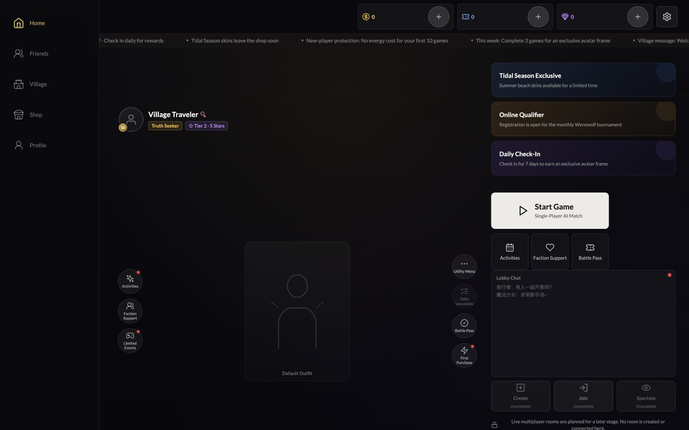
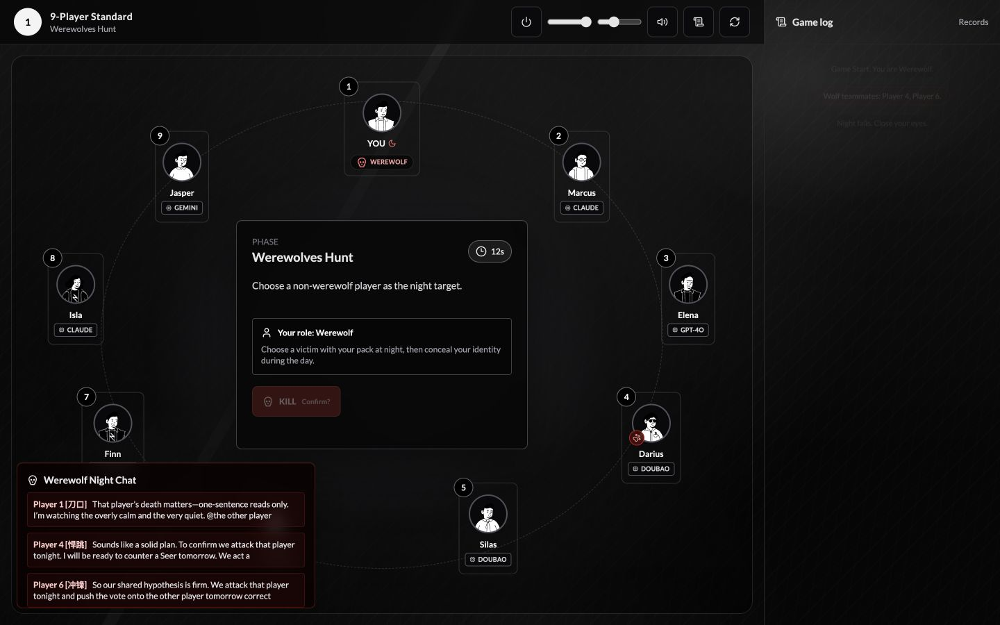
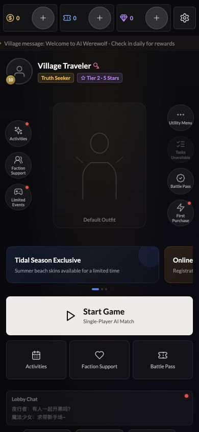
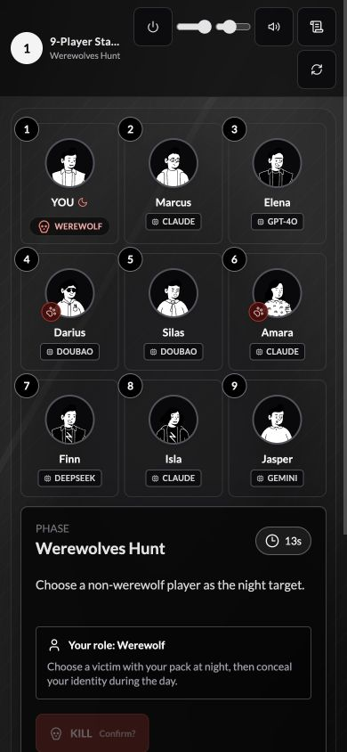
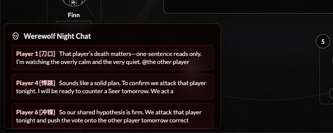

# AI Werewolf

AI Werewolf is a browser-based social deduction game where one human player faces strategic AI agents in complete, rules-driven Werewolf matches.

[](https://github.com/xuxuduoduo616/aiwerewolf/actions/workflows/deploy.yml)
[](https://react.dev/)
[](https://www.typescriptlang.org/)

**Live demo:** [ai-werewolf.net](https://ai-werewolf.net)

The project separates game rules from generated expression. A deterministic rules engine and belief/action layer decide what agents know and do; the language layer turns those decisions into characterful dialogue and falls back to a bundled speech library when the external AI provider is unavailable.

## Latest release (2026-11-14)

- Verification tail for the 2026-11-13 release: deterministic browser E2E for the replay and share-card specs, independent Playwright smoke and deep CI jobs, roadmap and observability documentation sync, page-hidden abandonment telemetry, and 60-second voice recording coverage. No new product features, multiplayer, payments, or social features.
- Release verification: 1,150 tests passed / 5 skipped; TypeScript and Vite build passed; the GitHub Actions E2E smoke and deep jobs pass on the release commit. Production deployment is verified separately through the existing Netlify Git integration.
- Voice input still requires the server-side `QWEN_API_KEY` environment variable. iOS Safari real devices, noise conditions, and full 60-second human recordings remain unverified.

## Previous production release (2026-11-13)

- Release identity: local `main`, `origin/main`, the GitHub `main` branch, and the Netlify production commit all match `d19c20d45f611ba3c4a9374e392019b29bf20998`; Netlify production deploy `6af6c4a66e12bd081a49320a` is ready.
- Post-game replay review, client-side share card, and click-to-record voice input shipped with this release.
- Release verification: 1,131 tests passed / 5 skipped; TypeScript and Vite build passed.
- Not verified: iOS Safari real devices, full 60-second recordings, noise environments, the all-player replay matrix, and refresh-abandonment statistics.

## Previous production release (2026-11-09)

- Release identity: local `main`, `origin/main`, the GitHub `main` branch, and the Netlify production commit all match `d3bc477b3efeb3954ac55e606e9fe62421c7d9e9`; Netlify production deploy `6af1b6b7b22bb26aa431fd64` is ready, and GitHub Actions run `42613934667` completed successfully. This release is confirmed in production.
- Every English AI player now speaks with a distinct voice: 11 Premium English voices are assigned by seat, so all AI players in 9-player and 12-player matches sound different. Chinese speech keeps its existing voices, and browser fallback stays restricted to natural voices.
- Release verification: 915 passed / 5 skipped, and the build with cloud speech enabled passed. The production homepage returned 200; the speech endpoint returned 405 for GET and 401 for anonymous POST from the production origin.
- Not verified: real-account email OTP, authenticated cloud writes, how the 11 voices actually sound, external AI provider reliability, and any guarantee for arbitrary input languages.

## Previous UI refinement (2026-11-06)

- Refined login and lobby: restrained red headline, clearer single-player start action, and responsive navigation.
- Activity promotions and payment entry points are hidden through presentation switches; their components and underlying logic remain available in source.
- Local browser checks covered seven viewport sizes and 9/12-player launch flows; real-account OTP and cloud writes were not exercised.

## Features

- Complete single-player matches against AI-controlled players
- 9-player and 12-player boards with Villager, Werewolf, Seer, Witch, Hunter, and Idiot roles
- Three difficulty levels and role-specific AI behavior profiles
- Belief tracking, strategic action selection, wolf-team coordination, voting, last words, and win resolution
- Post-game replay review with suspicion curves, vote reasons, and werewolf night chat
- Client-side share card export for a finished match
- Click-to-record voice input with editable transcription
- Per-match dialogue refinement with server-verified Gemini 3.6 Flash, Gemini 2.5 Flash fallback, and local speech fallback
- Email OTP authentication, guest trial, local guest records, and player statistics
- Responsive desktop, tablet, and mobile layouts with keyboard and safe-area support
- English application interface with source-authored player and AI dialogue preserved
- Production hosting on Netlify with build verification through GitHub Actions

Multiplayer rooms, premium purchases, real rewards, and live payment processing are intentionally unavailable. Their visible UI is a roadmap preview and does not create rooms, charge users, or grant assets.

## Screenshots

### Lobby



### Gameplay



| Mobile lobby | Mobile gameplay |
| --- | --- |
|  |  |

### AI Conversation



## Technology Stack

| Area | Technology |
| --- | --- |
| Frontend | React 18, TypeScript, Vite, Tailwind CSS |
| Game and AI logic | TypeScript rules engine, belief tracker, action selector, local speech library |
| AI provider | Server-verified Gemini 3.6 Flash, Gemini 2.5 Flash fallback, and local speech fallback |
| Authentication and data | Supabase Auth and Postgres |
| Hosting | Netlify CDN and Functions |
| Continuous integration | GitHub Actions production-build verification |
| Testing | Vitest and Playwright |

## Current Development Status

| Feature | Status |
| --- | --- |
| Core 9-player and 12-player gameplay | Complete |
| AI decision and dialogue pipeline | Complete |
| Responsive desktop/mobile interface | Complete |
| English application interface | Complete |
| Guest trial and email OTP integration | Complete |
| Player profile and game-record integration | Complete; production data policy verification remains owner-operated |
| Social lobby surfaces | Preview only |
| Real-player multiplayer | Planned |
| Payment processing | Disabled; provider integration not configured |
| Cloud text-to-speech | Complete for AI speech; browser fallback remains |
| Post-game replay review | Complete; local replay storage |
| Share card export | Complete; client-side PNG |
| Voice input | Complete; requires `QWEN_API_KEY` |

## Architecture

```text
React interface
  |-- game state hook --------------------+
  |                                       |
  +--> deterministic game engine          |
  +--> belief tracker + action selector   |-- complete match state
  +--> speech library + selected model ---+

Browser --> Netlify CDN / Functions --> Gemini
   |
   +--> Supabase Auth / Postgres
```

The browser can run a full match without an AI API key. Setup safely starts with Gemini 2.5 Flash and shows Gemini 3.6 Flash only after the server atomically verifies both exact model IDs with read-only access. A request uses the server-owned Gemini 3.6 → Gemini 2.5 → local speech fallback chain. Model choice affects dialogue and wolf chat, never deterministic rules or action selection. Provider keys and Supabase service-role credentials must never be exposed to the frontend. See [Architecture](docs/architecture.md) for module boundaries and security constraints.

## Local Development

Prerequisites: Node.js 20 and npm.

```bash
git clone https://github.com/xuxuduoduo616/aiwerewolf.git
cd aiwerewolf
npm install
npm run dev
```

The Vite development server uses local fallback dialogue. To exercise Netlify Functions locally, install or use the included Netlify CLI and run `npx netlify dev` after configuring the required environment variables.

```bash
npm run test:run
npm run build
```

Copy `.env.example` to `.env.local` for local configuration. Never commit `.env.local` or server credentials.

| Variable | Purpose |
| --- | --- |
| `API_KEY` | Server-side Gemini access |
| `VITE_SUPABASE_URL` | Public Supabase project URL |
| `VITE_SUPABASE_ANON_KEY` | Public Supabase anonymous key |
| `VITE_TURNSTILE_SITE_KEY` | Public Cloudflare Turnstile site key required by production builds |
| `SUPABASE_SERVICE_ROLE_KEY` | Server-only Supabase administration; never expose to the browser |
| `ALLOWED_ORIGIN` | Production CORS allowlist |

More detail is available in [Development](docs/development.md) and [Supabase setup](docs/supabase-setup.md).

## Roadmap

- **v1.0 - Playable AI Werewolf:** two boards, full role resolution, AI strategy, responsive UI, authentication, and production deployment
- **v1.1 - AI quality:** shipped 2026-11-13 with post-game replay review, a local replay benchmark and three-tier difficulty calibration on local real-match samples, a client-side share card, and click-to-record voice input; remaining dialogue placeholders, fallback-language consistency, and speech-corpus licensing are deferred
- **v1.2 - Social foundation:** planned; profiles, friend relationships, messaging, presence, moderation boundaries, and verified row-level security
- **v2.0 - Server-authoritative multiplayer:** planned; private rooms, invitations, reconnect support, secret-state projection, and idempotent game commands

See [Roadmap](docs/roadmap.md) for scope and release gates. Local verification notes and limits: [AI quality report](docs/ai-quality-report.md), [observability operations](docs/observability-operations.md). Planned work is not presented as an available feature.

## Contributing

Bug reports and focused improvements are welcome. Please read [CONTRIBUTING.md](CONTRIBUTING.md) before opening an issue or pull request. Security concerns should follow [SECURITY.md](SECURITY.md) rather than a public issue.

## License and Data Notice

This repository is currently source-available under the terms in [LICENSE](LICENSE); it is not yet released under an OSI-approved open-source license.

The provenance and redistribution rights of the bundled role-specific speech corpus are still being reviewed. Do not redistribute or reuse corpus files independently. A permissive software license will be considered only after those rights are resolved or the corpus is replaced.
