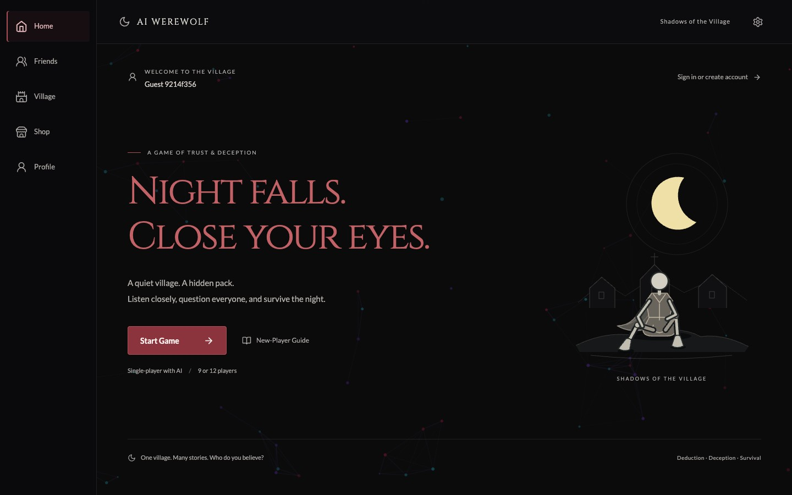
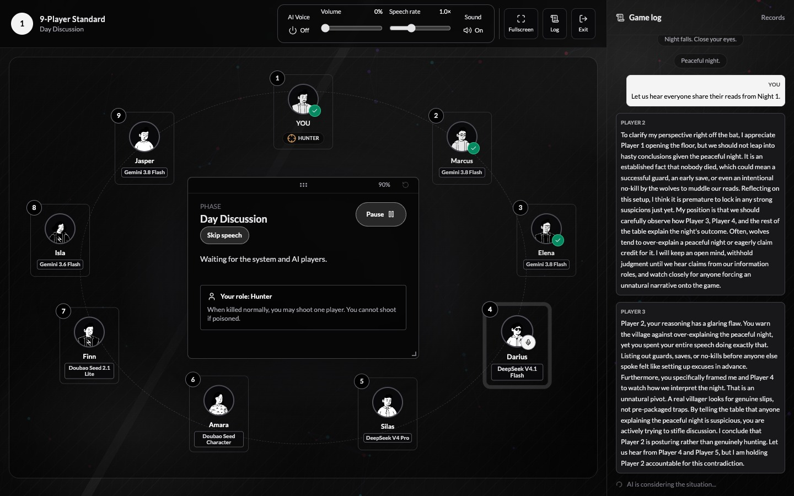
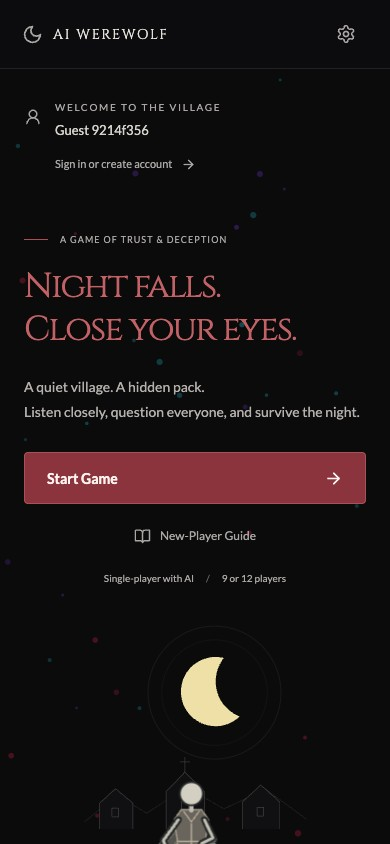
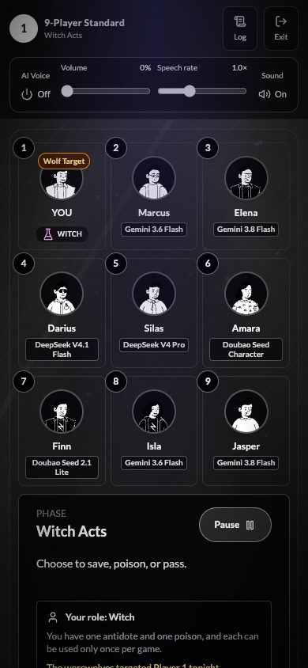
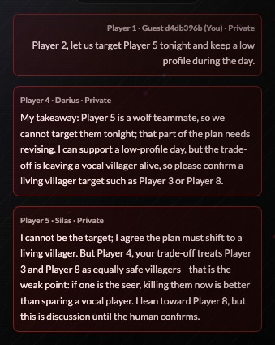

# AI Werewolf

AI Werewolf is a browser-based social deduction game where one human player faces strategic AI agents in complete, rules-driven Werewolf matches.

[](https://github.com/xuxuduoduo616/aiwerewolf/actions/workflows/deploy.yml)
[](https://react.dev/)
[](https://www.typescriptlang.org/)

**Live demo:** [ai-werewolf.net](https://ai-werewolf.net)

The project separates game rules from generated expression. A deterministic rules engine and belief/action layer decide what agents know and do; the language layer turns those decisions into characterful dialogue and falls back to a bundled speech library when the external AI provider is unavailable.

## Current interface

- The six-step new-player guide connects the lobby, Shop, Start Game, Single-Player, and match setup in one sequence, including when replayed. Prompts share a consistent bottom position; Next advances and Skip dismisses the current guide.
- Profile shows the verified skin inventory, including the permanent Default Outfit. Coins earned through Daily Check-In can unlock Basic skins; equip an owned skin from Shop or Profile to display it in the lobby.
- A responsive particle background supports pointer interaction and respects reduced-motion preferences.
- Role knowledge badges distinguish Seer checks from the Witch's saved or attacked player information without revealing another role's private checks.
- Voice input requires the server-side `QWEN_API_KEY`. iOS Safari real devices, noise conditions, and full 60-second human recordings remain unverified.

## Features

- Complete single-player matches against AI-controlled players
- 9-player and 12-player boards with Villager, Werewolf, Seer, Witch, Hunter, and Idiot roles
- Three difficulty levels and role-specific AI behavior profiles
- Belief tracking, strategic action selection, wolf-team coordination, voting, last words, and win resolution
- Post-game replay review with suspicion curves, vote reasons, and werewolf night chat
- Client-side share card export for a finished match
- Click-to-record voice input with editable transcription
- Multi-AI Models matches with stable seat assignments across the verified pool (Gemini 3.6 Flash, Gemini 3.8 Flash, DeepSeek V4.1 Flash, DeepSeek V4 Pro, and Doubao Seed routes), a side-by-side Single-Model Options entry housing Gemini 2.5 Flash and discovered single models, and truthful fallback badges
- Email OTP authentication, guest trial, local guest records, and player statistics
- Responsive desktop, tablet, and mobile layouts with keyboard and safe-area support
- English application interface with source-authored player and AI dialogue preserved
- Production hosting on Netlify with build verification through GitHub Actions

Multiplayer rooms, premium purchases, real rewards, and live payment processing are intentionally unavailable. Their visible UI is a roadmap preview and does not create rooms, charge users, or grant assets.

## Screenshots

### Lobby



### Gameplay



| Mobile lobby | Mobile gameplay |
| --- | --- |
|  |  |

### AI Conversation



## Technology Stack

| Area | Technology |
| --- | --- |
| Frontend | React 18, TypeScript, Vite, Tailwind CSS |
| Game and AI logic | TypeScript rules engine, belief tracker, action selector, local speech library |
| AI provider | Gemini 3.6 Flash / 3.8 Flash + DeepSeek V4.1 Flash / V4 Pro + Doubao Seed Character / 2.1 Lite (legacy 1.6 Flash route retained); Gemini 2.5 Flash backup and local dialogue |
| Authentication and data | Supabase Auth and Postgres |
| Hosting | Netlify CDN and Functions |
| Continuous integration | GitHub Actions production-build verification |
| Testing | Vitest and Playwright |

## Current Development Status

| Feature | Status |
| --- | --- |
| Core 9-player and 12-player gameplay | Complete |
| AI decision and dialogue pipeline | Complete |
| Responsive desktop/mobile interface | Complete |
| English application interface | Complete |
| Guest trial and email OTP integration | Complete |
| Player profile and game-record integration | Complete; production data policy verification remains owner-operated |
| Social lobby surfaces | Preview only |
| Real-player multiplayer | Planned |
| Payment processing | Disabled; provider integration not configured |
| Cloud text-to-speech | Complete for AI speech; browser fallback remains |
| Post-game replay review | Complete; local replay storage |
| Share card export | Complete; client-side PNG |
| Voice input | Complete; requires `QWEN_API_KEY` |

## Architecture

```text
React interface
  |-- game state hook --------------------+
  |                                       |
  +--> deterministic game engine          |
  +--> belief tracker + action selector   |-- complete match state
  +--> speech library + selected model ---+

Browser --> Netlify CDN / Functions --> Gemini / DeepSeek / Doubao
   |
   +--> Supabase Auth / Postgres
```

The browser can run a full match without an AI API key. In match setup, **Dialogue Model** presents **Multi-AI Models** on the left as the only top-level directly selectable mode and **Single-Model Options** on the right as an expandable single-model disclosure entry. **Multi-AI Models** uses the discovered subset of Gemini 3.6 Flash, Gemini 3.8 Flash, DeepSeek V4.1 Flash, DeepSeek V4 Pro, Doubao Seed 1.6 Flash, Doubao Seed Character, and Doubao Seed 2.1 Lite. Expanding **Single-Model Options** lists Gemini 2.5 Flash (the safe single-model default and Gemini fallback) alongside Automatic · DeepSeek by difficulty and every discovered Gemini, DeepSeek, or Doubao model; expanding or collapsing the list preserves the current selection and displays the active single model on the summary card when collapsed. Setup also provides an accessible participating-model list; read-only discovery proves metadata access (via direct Gemini model lookup or the Netlify AI Gateway provider catalog when `GOOGLE_GEMINI_BASE_URL` is injected, plus DeepSeek and Volcano Ark `/models`), not successful generation, client acceptance, or account balance. At start, AI seats receive stable round-robin routes, independently of personality, role, and difficulty. Daytime and private night chat use each speaker's assigned model. DeepSeek effort remains low/high/max for Beginner/Intermediate/Expert; it never changes a mixed-pool seat's model. Gemini 3.6 Flash and Gemini 3.8 Flash use minimal thinking and can fall back to Gemini 2.5 Flash; DeepSeek and Doubao routes make one bounded upstream call (with Doubao's single HTTP 400 minimal-body compatibility retry) before local fallback, within existing budgets and cancellation. Badges distinguish assigned routes, accepted actual models, unverified sources, and local dialogue. When a mixed-model turn has no usable reply after trying verified alternatives, that turn is skipped. Single-model turns can use local dialogue. Rules and actions remain deterministic. Provider keys and Supabase service-role credentials remain server-only. See [Architecture](docs/architecture.md), [DeepSeek integration](docs/deepseek-integration.md), and [Doubao integration](docs/doubao-integration.md).

## Local Development

Prerequisites: Node.js 20 and npm.

```bash
git clone https://github.com/xuxuduoduo616/aiwerewolf.git
cd aiwerewolf
npm install
npm run dev
```

The Vite development server uses local fallback dialogue. To exercise Netlify Functions locally, install or use the included Netlify CLI and run `npx netlify dev` after configuring the required environment variables.

```bash
npm run test:run
npm run build
```

Copy `.env.example` to `.env.local` for local configuration. Never commit `.env.local` or server credentials.

| Variable | Purpose |
| --- | --- |
| `API_KEY` / `GEMINI_API_KEY` | Server-side Gemini access (or injected by Netlify AI Gateway alongside `GOOGLE_GEMINI_BASE_URL` in Functions v2) |
| `DEEPSEEK_API_KEY` | Server-side DeepSeek access |
| `ARK_API_KEY` | Server-side Volcano Ark (Doubao) access |
| `VITE_SUPABASE_URL` | Public Supabase project URL |
| `VITE_SUPABASE_ANON_KEY` | Public Supabase anonymous key |
| `VITE_TURNSTILE_SITE_KEY` | Public Cloudflare Turnstile site key required by production builds |
| `SUPABASE_SERVICE_ROLE_KEY` | Server-only Supabase administration; never expose to the browser |
| `ALLOWED_ORIGIN` | Production CORS allowlist |

More detail is available in [Development](docs/development.md) and [Supabase setup](docs/supabase-setup.md).

## Product Scope

The released game is single-player with AI opponents. Social interaction and human multiplayer require further server-authoritative work; payment processing remains disabled. These boundaries apply to the demonstration and source distribution alike.

## Contributing

Bug reports and focused improvements are welcome. Please read [CONTRIBUTING.md](CONTRIBUTING.md) before opening an issue or pull request. Security concerns should follow [SECURITY.md](SECURITY.md) rather than a public issue.

## License and Data Notice

This repository is currently source-available under the terms in [LICENSE](LICENSE); it is not yet released under an OSI-approved open-source license.

The provenance and redistribution rights of the bundled role-specific speech corpus are still being reviewed. Do not redistribute or reuse corpus files independently. A permissive software license will be considered only after those rights are resolved or the corpus is replaced.
